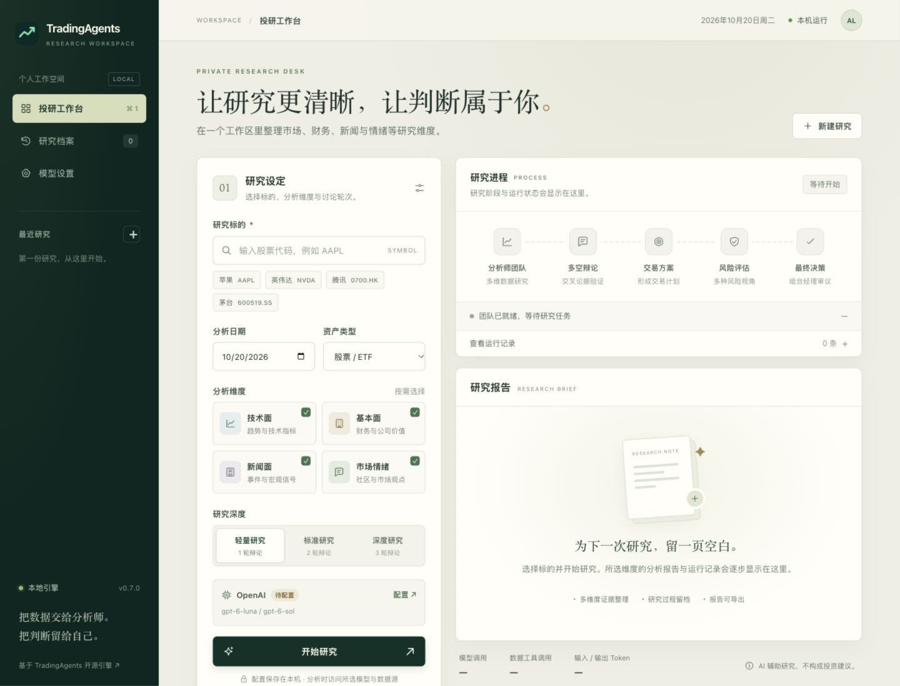
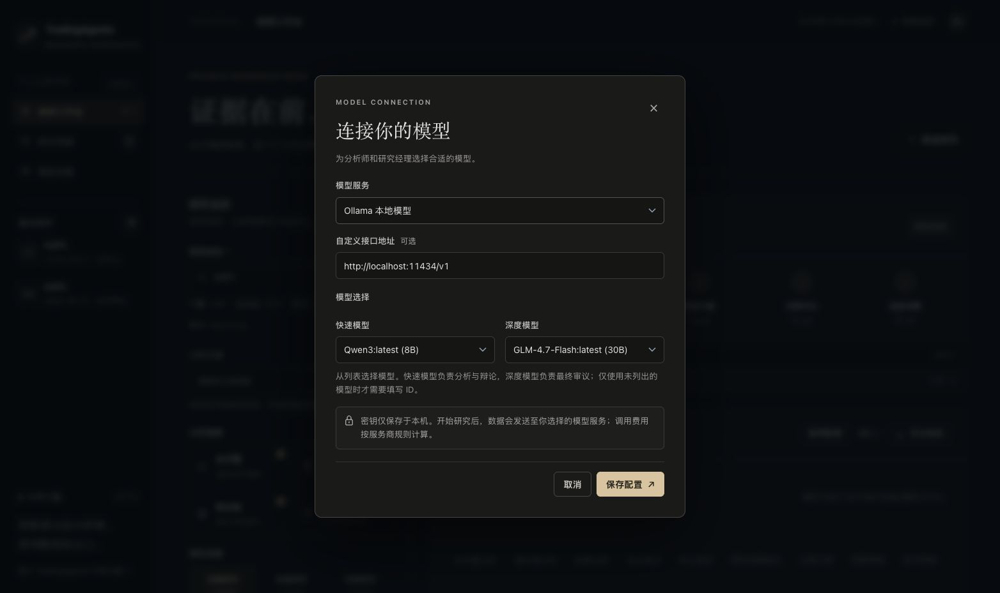
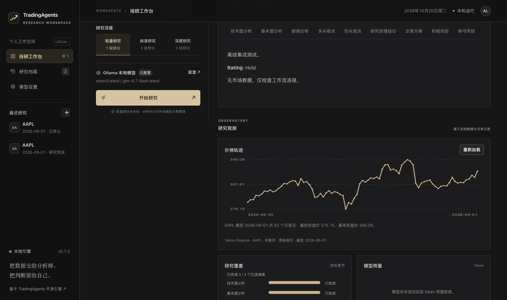
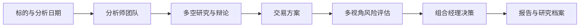

<div align="center">


# TradingAgents Workspace

**让 AI 投研流程看得见，让每一次研究留得住。**

基于 [TauricResearch / TradingAgents](https://github.com/TauricResearch/TradingAgents) 的中文本地投研工作台。
用浏览器完成模型配置、研究发起、进程跟踪、报告阅读与历史归档。

[快速开始](#快速开始) · [功能](#你可以做什么) · [使用说明](webapp/README.md) · [原版文档](README.upstream.md) · [更新记录](docs/CHANGELOG.workspace.md)


</div>



<details>
<summary>查看模型设置界面</summary>



</details>

<details>
<summary>查看行情与研究覆盖图表</summary>



</details>

## 为什么做这个

原版 TradingAgents 将分析师、研究员、交易员和风险经理组织成一套多 Agent 研究流程。这个版本在原引擎上增加了完整的图形工作台：无需在终端回答一连串问题，也能查看研究进行到哪一步、不同角色提供了哪些证据，以及最终结论从何而来。

这是一套**投资研究辅助工具**。它生成分析、观点和评级；并未接入券商下单，也不能用报告的完整程度来证明策略有效。

## 你可以做什么

| 能力 | 工作台体验 |
| --- | --- |
| 发起研究 | 输入股票代码与分析日期，自动识别资产类型，选择分析团队和辩论深度 |
| 模型配置 | 选择模型服务，在下拉列表中选择快速模型、深度模型；支持刷新订阅可用模型与显式自定义 |
| 可视化 | 加载截至分析日的价格轨迹，查看报告覆盖与实际 Token 分配 |
| 观察进程 | 查看分析、辩论、交易方案、风控和决策各阶段，以及工具调用记录 |
| 阅读报告 | 技术面、基本面、新闻、情绪、多空观点和风险意见按章节展示 |
| 管理任务 | 后台运行、主动停止；刷新页面恢复视图，中断后从可用检查点继续 |
| 研究归档 | 自动保存历史，按代码或服务商搜索，复用配置重新研究 |
| 导出成果 | 下载 HTML 或 Markdown，HTML 可通过浏览器打印为 PDF |
| 本地运行 | 界面无外部字体或前端 CDN 依赖，密钥不存入浏览器存储 |

**流程保留原版引擎：**



## 快速开始

需要 **Python 3.11 或更高版本**。推荐使用 Python 3.13。

先运行 `python3.13 --version`（Windows 为 `py -3.13 --version`）确认已安装。macOS 自带的 `python3` 可能低于 3.11；若使用其他受支持版本，请将下面的解释器名称替换为实际版本。

### macOS / Linux

```sh
git clone https://github.com/Alan0124/tradingagents-workspace.git
cd tradingagents-workspace
python3.13 -m venv .venv
source .venv/bin/activate
python -m pip install -e .
tradingagents-web --open
```

### Windows PowerShell

```powershell
git clone https://github.com/Alan0124/tradingagents-workspace.git
cd tradingagents-workspace
py -3.13 -m venv .venv
.\.venv\Scripts\Activate.ps1
python -m pip install -e .
tradingagents-web --open
```

浏览器会自动打开本机工作台，默认地址为 `http://127.0.0.1:18765`。若端口已被占用，服务会选择可用端口，并输出实际地址。

### macOS 桌面入口

在完成上述安装后运行一次：

```sh
python -m webapp.install_desktop
```

之后双击桌面的 **TradingAgents 投研台.app** 即可打开。启动器绑定当前目录；移动项目或虚拟环境后请重新生成。

源码目录内也可双击 **启动 TradingAgents.command**，`webapp/launch.command` 共用同一入口，均打开浏览器工作台。`.command` 在终端前台运行服务，关闭终端会结束服务；桌面 `.app` 在后台运行，日志位于 `.local/web/server.log`。原命令行分析请在虚拟环境中运行 `tradingagents`。

### 第一份研究

1. 打开「模型设置」，选择服务商，填写对应的 API Key。
2. 从下拉列表选择快速模型与深度模型，保存配置。订阅模型可点击「刷新可用模型」获取账号实际可见选项；只有列表外的自定义服务需要手动输入 ID。
3. 输入标的，系统自动识别资产类别。例如 `AAPL`、`NVDA`、`0700.HK` 或 `600519.SS`。
4. 选择日期、分析团队和研究深度，然后点击「开始研究」。
5. 报告章节会随流程逐步出现，任务完成后可查看最终评级并导出。

「已配置」表示配置字段齐全，**不代表模型或数据源已经通过连通性验证**。API 调用按服务商规则计费；更多分析师与辩论轮次通常需要更多调用。

## 模型与数据

工作台提供 OpenAI、DeepSeek、Anthropic、Google、通义千问、智谱、Kimi、MiniMax、OpenRouter 等服务选项，也支持 Ollama 和自定义 OpenAI 兼容接口。模型候选项来自原引擎目录，你可以输入新的或自定义的模型 ID。

- **快速模型：**分析师、研究员、风险讨论和交易员。
- **深度模型：**研究经理与组合经理。
- **Ollama：**需要提前启动本地服务并拉取模型。
- **ChatGPT 订阅：**复用原项目的浏览器登录实现，实际可用性需以账号授权结果为准。

行情图、技术指标和数值核验报告共用一个日线入口：默认沪深 A 股走东方财富不复权行情（人民币、成交量为股），其他标的走 Yahoo Close。每次 Web 研究固定首次获取的行情快照，后续图表继续使用同一份数据。[来源、单位、配置和日期口径](docs/market-data.md)。

财报、新闻与社交数据沿用原项目的数据工具。不同市场的数据覆盖并不相同；A 股、港股或加密资产的代码可被识别，不代表所有研究维度的数据都完整。

新工作台研究没有可核验的有效证据时（包括未调用任何数据工具、零采集记录），最终决策为 `REVIEW`，不生成方向性评级或目标价。旧报告仍保留原始评级及“未验证”状态。

## 本地数据与隐私

| 内容 | 源码安装时的默认位置 |
| --- | --- |
| 模型密钥 | 项目根目录 `.env` |
| 界面偏好、历史任务与报告 | `.local/web/` |
| 每次研究的证据、缓存与检查点 | `.local/web/runs/<任务 ID>/` |
| 原引擎记忆 | `~/.tradingagents/` 或原配置指定路径 |
| 桌面启动日志 | `.local/web/server.log` |

`.env`、`.local/`、缓存和生成报告均不应提交到 Git。服务仅监听本机回环地址；写入接口校验来源与会话令牌，报告渲染禁用原始 HTML。

安装 wheel 时，工作台会将可写数据放在 `~/.tradingagents/workspace/`，避免写入包安装目录。可用 `TRADINGAGENTS_WORKSPACE_DIR` 指定工作空间。

本地运行不等于分析数据完全离线：开始研究后，数据工具会访问外部来源，所选模型服务会接收分析所需的上下文。关闭浏览器也不会自动停止正在运行的任务，请使用页面上的停止按钮。

## 开发与测试

前端采用石墨黑 / 冷灰视觉、原生 HTML / CSS / JavaScript，无需 Node 构建步骤。后端使用 Python 标准库 HTTP 服务、SQLite 与原项目 LangGraph 流程。

```sh
pip install -e ".[dev]"

# 工作台测试与真实引擎离线集成测试
python -m unittest discover -s webapp/tests -v

# 前端语法与交互回归测试（需要 Node.js 22+）
node --check webapp/static/app.js
node --check webapp/static/visuals.js
node --test webapp/tests/frontend*.test.*

# 原引擎测试
pytest -q
```

离线测试使用脚本模型验证工作流接线与结果保存，不证明真实模型的分析质量。真实 API、外部数据服务及 ChatGPT 登录需使用自己的凭据验证。

```text
webapp/
├── static/             # 浏览器界面与交互
├── core.py             # 配置、校验、历史存储、任务管理
├── server.py           # 本地 HTTP API 与启动流程
├── worker.py           # 独立进程中的原引擎分析
├── install_desktop.py  # macOS 桌面启动器生成
└── tests/              # 离线单测、引擎集成与前端回归测试
tradingagents/           # 上游分析引擎
cli/                    # 保留原版命令行入口
```

## 边界与已知限制

- 当前一次运行一个研究任务；服务重启后，未完成任务会标记为中断，已收到的报告保留。
- 中断、失败或停止的研究可点击「继续研究」，按原配置从该任务的可用检查点恢复；没有检查点的旧任务需重新研究。已在途的模型请求可能需要重试并产生费用。
- 界面当前不提供完整投资组合回测或实盘下单；CLI 的 `tradingagents backtest` 评估历史评级，不模拟滚动持仓与成交。
- Token 数量取决于服务商是否返回使用量；不能据此推算统一成本。
- LLM 输出存在波动，数据源可能缺失、限流或不可用；历史日期分析也不能消除模型训练知识带来的偏差。

## 致谢与许可

本项目基于 [TauricResearch/TradingAgents](https://github.com/TauricResearch/TradingAgents)，保留其原版 Python 分析引擎与命令行入口，并扩展本地浏览器工作台。原始研究和引用信息见 [上游 README](README.upstream.md)。

代码使用 [Apache License 2.0](LICENSE)。本项目并非 Tauric Research 官方界面，也未得到其背书。
